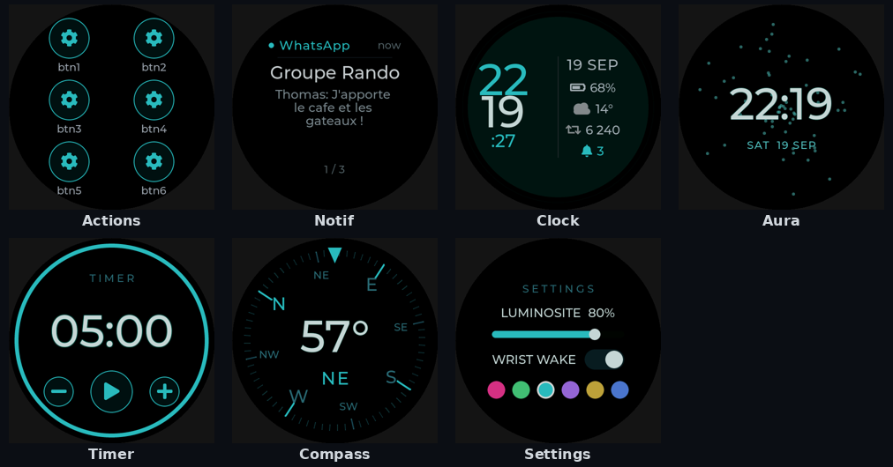

# Watch — round smartwatch UI (LVGL) + PC emulator

Firmware UI and a **PC emulation environment** for a round smartwatch, targeting the
[Waveshare **ESP32-S3-Touch-AMOLED-1.43**](https://www.waveshare.com/product/esp32-s3-touch-amoled-1.43.htm)
(ESP32-S3, round **AMOLED 466×466** QSPI, capacitive touch **FT3168**, **QMI8658** IMU,
**PCF85063** RTC, BLE).

The UI is written with **LVGL v9** and kept **platform-independent**: the exact same UI
source runs on the PC and (later) on the device — only a thin driver layer changes. That
lets the whole watchface be developed, screenshotted and unit-tested on a desktop before
any hardware is involved.



> License: **Apache-2.0** · Status: **emulator complete, device drivers are the next milestone**

## Features

- **Swipeable faces** in an `lv_tileview` — a horizontal strip plus vertical pairs:
  `actions | notifications | [clock ⇅ aura] | settings | debug | [apps ⇅ level]`.
- **Dual-display clock** (Casio-style): big LCD time + status column (date, battery,
  weather placeholder, activity placeholder, unread bell).
- **Aura** living watchface: a motion-reactive particle field (energy from the IMU).
- **Notifications**: a latest-notification card (tap to dismiss & advance); an unread
  **bell** appears on the clock. Fed by a BLE stand-in on PC.
- **Action buttons**: a customizable 2×3 shortcut grid; a press fires a BLE signal
  (stubbed on PC). The model is ready for later phone-side customization.
- **6 accent "teintes"** applied consistently across every face (swap live in Settings,
  or tap the clock time).

## Repository layout

```
lv_conf.h        LVGL configuration (RGB565, fonts, CLIB malloc)
core/            pure LOGIC — unit-tested, NO LVGL/platform dependency
ui/              LVGL faces (turn core/ results into widgets) — shared by every target
  geometry.h     layout constants derived from the panel size (WATCH_SIZE)
  theme.{c,h}    palette + the 6 accent teintes
  fonts/         generated big-digit font (wf_digits_100)
  face_*.c       one module per face (create / tick / apply_accent)
  ui.c           face manager (tileview navigation, overlays, accent fan-out)
platform/        display + tick + HAL (PC framebuffer today, ESP32-S3 tomorrow)
shot/            headless target: renders one frame to a PNG (for CI / review)
sim/             interactive target: SDL2 window with mouse-as-touch
tests/           Unity unit tests for core/
third_party/     stb_image_write.h (PNG) + Unity (submodule)
lvgl/            LVGL v9 (submodule)
```

## Getting started

### Prerequisites
- CMake ≥ 3.16 and a C11 compiler
- `libsdl2-dev` (only for the interactive simulator; the headless PNG target needs no display)
  ```sh
  sudo apt install cmake build-essential libsdl2-dev
  ```

### Clone (with submodules)
LVGL and Unity are git submodules, so clone recursively:
```sh
git clone --recursive <repo-url>
cd watch
# already cloned without --recursive?
git submodule update --init --recursive
```

### Build
```sh
./build.sh          # configures + builds all targets into ./build
```

### Run
```sh
./build/watch_sim               # interactive SDL2 window (mouse = touch)
./shot.sh frame.png <face> <teinte>   # headless: render one face to a PNG
./test.sh                       # run the Unity/CTest suite
```
`<face>`: 0=actions 1=notifications 2=clock 3=aura 4=settings 5=debug 6=apps 7=level.
`<teinte>`: 0..5 (Rose, Vert, Cyan, Violet, Or, Bleu).

The UI reads the clock through the `watch_time()`/`watch_now()` HAL, so renders
can be pinned for deterministic screenshots:
```sh
WATCH_EPOCH=$(date -d "2026-09-22 10:09:42" +%s) ./shot.sh clock.png 2 2
```

`./pixels.sh` reports the black/lit pixel ratio per face (an AMOLED-power proxy);
`./pixels.sh --check` (also run in CI as the `amoled_budget` test) fails if any
face lights too many pixels — a guard against a bright background regressing.

## Test-driven development

Logic lives in `core/` with **no LVGL/SDL dependency**, so it runs as fast host unit
tests (Unity + CTest). The UI only translates `core/` results into widgets. Workflow for
any new behaviour:

1. **Red** — add a failing test in `tests/`.
2. **Green** — implement the pure logic in `core/`, run `./test.sh`.
3. **Refactor** the UI in `ui/`, confirm visually with `./shot.sh` (read the PNG).

Tested modules: `watchface_logic`, `timer`, `compass`, `settings`, `wrist`, `activity`,
`notify`, `actions`, `dotfont`.

## Fonts

Bundled Montserrat sizes (14–48) are enabled in `lv_conf.h`. The large time/heading
digits use a generated font `ui/fonts/wf_digits_100.c` (digits, `:` and `°` only),
produced from the Montserrat TTF that ships with LVGL:

```sh
npx lv_font_conv --font lvgl/scripts/built_in_font/Montserrat-Medium.ttf \
  --size 100 --bpp 4 --format lvgl --no-compress \
  --range 0x30-0x3A --range 0xB0 -o ui/fonts/wf_digits_100.c
```

## Bill of materials

The physical build targets the Waveshare board below; the rest are the battery,
connectors, charging and fasteners used for the prototype. Amazon links are
affiliate links (`tag=jnk00d-20`).

| Part | Description | Link |
|------|-------------|------|
| **Main board** | Waveshare ESP32-S3 1.43″ AMOLED round display (466×466, capacitive touch, ESP32-S3R8, Wi-Fi 2.4 GHz + BLE 5.0) | [Amazon](https://www.amazon.fr/dp/B0DV3KM88S?tag=jnk00d-20) |
| **Battery** | EEMB LiPo 3.7 V 500 mAh (562438), JST 2.0 connector | [Amazon](https://www.amazon.fr/dp/B09DPPMX14?tag=jnk00d-20) |
| **Connectors** | RUNCCI-YUN JST 1.25 mm 2-pin male/female, 15 cm leads (100 pcs) | [Amazon](https://www.amazon.fr/dp/B09TDCLZGB?tag=jnk00d-20) |
| **Charging cable** | Magnetic USB-C charging cable, 540° rotatable, 5 V/2 A (2-pack) | [Amazon](https://www.amazon.fr/dp/B0H6JB5NFQ?tag=jnk00d-20) |
| **Fasteners** | M2 countersunk hex-socket screw kit, grade 10.9, nuts + washers + Allen keys (410 pcs) | [Amazon](https://www.amazon.fr/dp/B0C1BLSBLW?tag=jnk00d-20) |

## Hardware port (next milestone)

The PC emulator is complete. Bringing it up on the ESP32-S3-Touch-AMOLED-1.43 means
implementing the HAL in `platform/` (the UI in `ui/` stays unchanged):

- **Display**: real `flush_cb` → GC-less **QSPI AMOLED (SH8601/CO5300)** DMA; switch to
  `LV_DISPLAY_RENDER_MODE_PARTIAL` with two partial buffers in **PSRAM** (a full 466²
  RGB565 frame is ~434 KB); handle the panel's RGB565 byte order.
- **Time**: add a `watch_now()` seam backed by the **PCF85063 RTC** (the faces currently
  read the host clock directly).
- **Touch**: an **FT3168** (I2C) pointer input device (the sim uses mouse→touch).
- **IMU / battery / backlight**: back `watch_read_accel`, `watch_battery_pct` and
  `watch_set_backlight` (AMOLED brightness is a DCS command, not a PWM backlight) with the
  QMI8658 / ADC / panel.

## Contributing

See [CONTRIBUTING.md](CONTRIBUTING.md).

## License

Licensed under the Apache License, Version 2.0 — see [LICENSE](LICENSE) and [NOTICE](NOTICE).
Third-party components (LVGL, Unity, stb, Montserrat) keep their own licenses.
